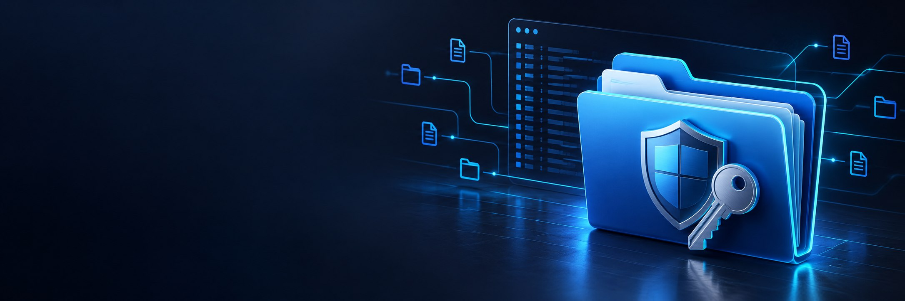

  
  <h1>File Control Manager v3.2.2</h1>
  
<strong>A keyboard-first PowerShell workspace for file operations and Windows security diagnostics.</strong>

  

    
    
    
    
    
  

  
<a href="#quick-start">Quick Start</a> · <a href="#capabilities">Capabilities</a> · <a href="#security-model">Security Model</a> · <a href="#verification">Verification</a>

---

FCM is a **PowerShell-only terminal application** for managing files and folders when Windows permissions make routine tasks difficult. It combines a keyboard-driven interface with native Windows tools and makes security-sensitive actions explicit.

> **Designed for clarity and control:** inspect a target first, understand the requested action, then confirm changes that affect ownership, permissions, or permanent deletion.

## At A Glance

| | |
|---|---|
| **Current Version** | 3.2.2 — see [VERSION](VERSION) and [CHANGELOG.md](CHANGELOG.md) |
| **Runtime** | Windows PowerShell 5.1 or PowerShell 7; no Python or third-party runtime |
| **Interface** | Interactive PowerShell TUI, optimized for Windows Terminal |
| **Security** | Uses native Windows ACL and EFS diagnostics; protected actions require confirmation |
| **License** | See [LICENSE](LICENSE) |

## Quick Start

1. Download or clone this repository on Windows.
2. Open PowerShell in the project folder.
3. Start FCM:

    .\FCM.bat

Or launch it directly:

    .\FCM.ps1

FCM checks its prerequisites before showing the menu. If the session needs elevation, Windows displays its standard UAC prompt. Accepting it opens the elevated session in Windows Terminal when available; otherwise FCM uses the available PowerShell console. Canceling the prompt exits without performing an operation.

Run non-elevated diagnostics at any time:

    .\FCM.ps1 -Version
    .\FCM.ps1 -SelfTest
    .\FCM.ps1 -SmokeTest

## Capabilities

| Action | What It Does |
|---|---|
| **Choose Target** | Select a file or folder for later actions |
| **Inspect** | Review metadata, Windows ACL permissions, and EFS status |
| **Rename** | Rename a file or folder without overwriting an existing name |
| **Copy / Move** | Copy or move an item into an existing destination folder |
| **Delete** | Permanently delete only after confirmation and typing DELETE |
| **Take Ownership** | Request ownership through Windows security tools after confirmation |
| **Grant Administrator Access** | Grant the local Administrators group Full Control after confirmation |
| **Administrator Session** | Open an elevated FCM session when a protected action needs it |
| **Activity Log** | Review recent actions recorded by FCM |

### A Deliberate Terminal Experience

The menu is keyboard-first: move with **Up/Down**, select with **Enter**, or type an action number. FCM updates only changed rows during navigation. Windows Terminal receives the initial dashboard as a synchronized frame to avoid revealing the screen one row at a time. Colors and icon fallbacks adapt to the terminal.

## Security Model

FCM works with Windows security controls; it does not bypass them.

- ACLs define access permissions. They are **not encryption**.
- FCM can report EFS status; it does **not** decrypt EFS or BitLocker-protected data.
- Ownership, permission changes, and permanent deletion require explicit confirmation.
- Copy, move, and rename refuse to overwrite an existing destination.
- FCM does not forcibly unlock files held open by another process.
- Activity is recorded as JSON Lines under the current user's LocalAppData folder.

## Requirements

- Windows 10 or Windows 11
- Windows PowerShell 5.1 or PowerShell 7
- Windows utilities: icacls.exe, cipher.exe, and takeown.exe
- Windows Terminal is recommended for the best interactive experience

PowerShell 6 is supported by the code but is not currently included in the automated test matrix.

## Verification

Run the project checks from PowerShell:

    .\tests\Test-TuiModules.ps1
    .\tests\Test-Operations.ps1
    .\tests\Test-FcmStartup.ps1

GitHub Actions runs the startup and operation checks on Windows PowerShell 5.1 and PowerShell 7. Automated checks cannot approve a real UAC prompt or guarantee Emoji rendering for every installed font.

## Configuration

Set FCM_ICONS to choose emoji, symbol, or ascii icons. Set NO_COLOR to disable color output. Redirected output uses readable ASCII icons.

---

**File Control Manager v3.2.2** · Built with PowerShell for Windows file operations and security diagnostics.
